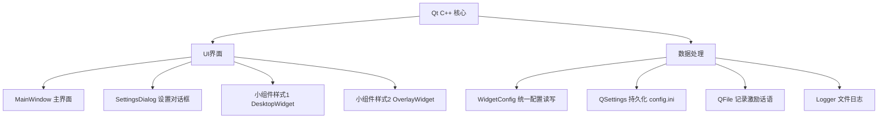

# BattleForFuture
这是一个适用于2026届高考生的倒计时小工具


> "乾坤未定，你我皆黑马！" - 让BattleForFuture成为你的高考战友

## 功能亮点

### 🚀 高考倒计时
- 动态显示距离高考和一模的天数
- 跨零点自动刷新，长期挂机也不会显示过期数字

### 💪 智能激励
- 每日随机励志名言（如"今日不肯埋头，明日何以抬头"）

### 🧩 两种桌面小组件样式（设置中随时切换）
| 样式 | 说明 |
| --- | --- |
| **样式 1 · 圆角卡片** | 圆角卡片，带「退出 / 返回主界面」按钮，支持自定义**背景色** |
| **样式 2 · 右下角透明区域** | 屏幕右下角的无边框、无标题栏、**完全透明**区域，只显示「距离一模/高考还有 N 天」，数字为 LCD 七段数码管 |

- 两种样式都支持鼠标拖动移动、双击返回主界面；
- 两种样式都可以自由定义**文字颜色**与 **LCD 数字颜色**，并可调整文字大小；
- 选择样式 2 时，「背景色」设置会自动禁用并给出原因提示（切回样式 1 自动恢复，原取值不会被清除）。

### 💻 跨平台显示
- Windows / Linux 行为一致：透明区域不会出现黑块（详见下文「Linux 透明实现」）。

## 技术架构



### 关键实现说明

**小组件样式 2 为什么不用 QSS `background: transparent`？**

Linux 桌面环境高度碎片化：QSS 的 `transparent` 只是让控件不绘制背景，顶层窗口的每个像素仍必须由窗口后端填充；X11 下若会话没有合成器（老 GNOME/XFCE 默认、i3/openbox 等纯 WM），未绘制的像素会被直接填成**黑色**——这就是「transparent 变黑」的根因。现在的做法是：

1. 启动时（`QApplication` 构造之前）请求带 Alpha 通道的默认表面格式；
2. `PlatformSupport` 探测当前会话是否真的支持逐像素 Alpha（Windows/DWM、macOS、Wayland、带合成器的 X11 判定为支持）；
3. 支持时走 `WA_TranslucentBackground`，只绘制文字与数码管；
4. 不支持时完全不申请透明表面，改为把内容画到离屏画布后用**像素级窗口遮罩**裁剪，桌面从缺口透出，任何桌面环境下都不会出现黑块。

两条路径的对外行为完全一致，且均为纯 QWidget + QPainter 实现，不需要 QML/Qt Quick 运行时（可执行文件从 16.9 MB 降到 10.0 MB）。

## 安装指南

### Windows
1. 下载压缩包 `BattleForFuture.zip`
2. 解压到指定位置
3. 启动程序 `BattleForFuture.exe`

### Linux
1. 解压 `BattleForFuture.tar.gz`
2. 确保已安装 Qt 6 运行库与 xcb 平台插件
3. 运行 `./BattleForFuture`

> 若你的 X11 会话确实有合成器但被判定为不支持，可设置环境变量 `BFF_ASSUME_COMPOSITED=1` 强制启用透明。

## 使用教程
```
1. 主页上的"小部件模式"按钮，可以让程序化身为桌面小组件。
2. 打开设置 → 小组件设置，可以在"样式 1（圆角卡片）"与
   "样式 2（右下角透明区域）"之间自由切换，并自定义文字颜色、
   LCD 数字颜色、文字大小与倒计时目标。
3. 打开设置 → 常规设置，可以设定开机自启动、启动后直接进入的界面、
   显示语言与参加高考年份。
4. 打开设置 → 文字编辑，可以快捷地修改适合你的鼓励语句。
5. 小组件上用鼠标拖动可移动位置，双击可返回主界面。
```

### 开发环境

- Qt 6.11.1（Qt 6.2+ 均可）
- qmake
- MinGW 13.1 / MSVC 2022（x86_64）

### 项目结构
```
BattleForFuture/
├── main.cpp                 # 入口：表面格式、会话校验、单实例、启动形态
├── mainwindow.{h,cpp}       # 主界面 + 小组件宿主
├── settingsdialog.{h,cpp}   # 设置对话框（分类导航、页面惰性构建）
├── desktopwidget.{h,cpp}    # 小组件样式 1：圆角卡片（记忆窗口位置）
├── overlaywidget.{h,cpp}    # 小组件样式 2：右下角透明区域（固定停靠、禁止拖动）
├── sevensegmentdisplay.{h,cpp} # 自绘 LCD 七段数码管（主页倒计时数字）
├── widgetstyle.{h,cpp}      # 小组件配置的统一读写（WidgetConfig，含位置记忆）
├── textutils.{h,cpp}        # 简体 -> 繁体运行时转换（繁体界面支持）
├── platformsupport.{h,cpp}  # 平台能力探测（Linux 合成器判定）
├── appinstance.{h,cpp}      # 单实例协调（第二次启动唤醒已有窗口）
├── logger.{h,cpp}           # 文件日志
├── diagnostics.{h,cpp}      # 崩溃捕获 / 卡死监视 / 阶段埋点
├── mainwindow.ui            # 主界面布局
├── resource.qrc             # 图标与翻译资源
├── Assets/quotes.txt        # 励志名言库
└── BattleForFuture.pro      # 构建配置
```

## 更新日志

### 2.3.6
- **彻底去掉数字上的暗色“8”残影**：上一版只是跳过了“补位空格”，但**真实数字本身**
  仍会给未点亮的段涂一层低透明度颜色（本意是模拟数码管底纹），于是数字 6 的
  右上那段、数字 1 的左右两段都会隐约显出来。现在**只绘制点亮段**，
  未点亮段完全不画。实测数字 6：`b` 段墨迹 0，其余六段正常点亮。
- **修复最下面一横与数字主体错位**：段几何里下排竖段 `e/c` 的起点原先写成了
  `厚度 + armLen`（即从**中间横段的上沿**开始），导致下排竖段在中间横段处多出一截、
  又在距底部 1 个段厚的地方提前结束，底段看起来就“飘”在下面。
  改为从 `2×厚度 + armLen`（中间横段的**下沿**）开始后，下排竖段正好与底段相接。
  实测（数字 0，63×110）：竖段末行 96、底段首行 97（相邻无缝隙），
  底段末行 109 与数字底边齐平，底段水平起点 13、宽度 37，均符合预期。
  样式 2（右下角透明区域）用的是同一套段几何，已同步修正。
- **“推送鼓励语句”改为系统通知**：新增 `Notifier` 模块，勾选项文案调整为
  “应用程序启动时推送鼓励语句（系统通知）”。跨平台策略分三层：
  1. 首选 `QSystemTrayIcon::showMessage()`（Windows 托盘气泡/操作中心、
     macOS 通知中心、多数 Linux 桌面经 D-Bus 交给通知守护进程）；
  2. Linux 无托盘时退化为调用 `notify-send`；
  3. 两者都不可用时只记日志，绝不阻断启动。
  托盘图标惰性创建（只有启用推送才会出现），并带“显示主界面 / 退出”菜单。
  勾选该选项时会立即发一条预览通知，不必等下次启动才能验证。
  通知正文与首页显示的是**同一条**语句；首页语句不再受该开关影响（始终显示）。
  实测日志：`启动推送成功: 距离高考还有 0 天 / 人生没有白走的路，每一步都算数`。
- **修复复选框未勾选时边框不闭合**：原来用 QSS 的 `background-color + border` 画指示器，
  而 Qt 分配给指示器的裁剪区域往往只等于 `width/height`（不含 border 宽度），
  边框会被裁掉/被白底盖住一段。现在指示器的四种状态（未勾选 / 悬停 / 禁用 / 勾选）
  **全部改为整幅 SVG 图片**（新增 `checkbox-unchecked*.svg`），边框由图片内容保证。
  实测 20×20 指示器四条边覆盖率均为 90%（其余 10% 是圆角），不再有缺口。

### 2.3.5
- **修复一模倒计时出现暗色“8”残影**：位数不足时（例如一模已过、只剩 `0`），
  补位空格被当成“没有点亮的数字”，把 7 段全部用熄灭色画了一遍，
  于是左侧未用的两位各留下一个完整的暗色“8”轮廓；而一直满位显示的高考倒计时看不到这个现象。
  现在绘制时**跳过补位空格**，未用的数位完全空白。
  实测补位空格区域绘制像素为 **0**（此前会画出两整组熄灭段）。
  数字本身的熄灭段（例如数字 `0` 中间那根横条）仍然保留，形态不变。
- **修复勾选推送后首页看不到鼓励语句**：
  1. 根因是该文字用 `QPainter` 自绘，取的是调色板 `WindowText`（Windows 上是纯黑），
     而首页背景是深色星空图 —— 黑字几乎完全看不见，看起来就像“没有推送内容”。
     现在给标签增加了显式文字颜色（浅蓝白 `#E8F2FF`），压在深色背景上清晰可读。
  2. 推送内容与首页显示统一为**同一条语句**：启动时随机抽取一次并记住
     （`m_pushedQuote`），首页显示与推送日志用的是同一个字符串，
     不会出现“推送的和主页显示的不是同一句”；只有用户编辑并保存语句后才会重新抽取。
  3. 推送开关的读取改为兼容 `true/1/yes/on` 等多种写法，设置界面的复选框用**同一套解析规则**，
     不会再出现“复选框没勾但实际在推送”的矛盾状态；勾选/取消立即生效，无需重启。
  实测启动日志：`首页推送语句: 处于低谷时，四面都是上坡路`。

### 2.3.4
- **修复分类导航选中项看不清**：上一版把高亮条画在 `QListWidget::paintEvent()` **之后**，
  等于用不透明底色把选中项的文字整个盖住了 —— 看起来就是“背景色和文字色一样”。
  现在改为**先铺高亮、再让列表画文字**，文字始终在高亮之上。
  实测选中行区域内仍有 1112 个白色文字像素（此前被完全覆盖）。
- **修复设置页滑动切换时的叠影**：`QStackedWidget::setCurrentIndex()` 会把目标页 `raise()`
  到最上层；上一版在它之后创建快照覆盖层虽然补了 `raise()`，但动画期间布局一旦被激活，
  当前页又会被重新抬起，于是“还没滑过去新页内容就出现 / 两页叠在一起”。
  现在动画期间**直接把真实页面隐藏**，画面完全由两张快照构成（两张快照恰好铺满内容区），
  动画结束再恢复页面可见。实测：动画中 `当前页可见=0、可见快照=2`；结束后 `可见=1、快照=0`。
- **倒计时数字与左右文字间距过大、整行不居中**：
  - 根因一：LCD 控件被布局拉宽，多出来的宽度变成数字两侧的空白。现在把控件改为
    固定尺寸策略，`sizeHint` 直接按“三位数字恰好所需宽度”计算，控件宽度与数字等宽
    （实测高考 201×110、一模 163×90，首位数字左侧留白 0）。
  - 根因二：`.ui` 里给自定义控件写的属性是**动态属性**，不会调用 C++ 的
    `setMinimumDigitCount()`，控件内部仍按默认值工作、只按一位数计算宽度。
    现改为在代码中显式设置最小位数（3）与数字颜色。
  - 根因三：整行两侧是 12px 固定间隔，内容无法居中。改为两侧可拉伸间隔（提示宽度 0），
    实测两行左右边距分别为 192/193 与 190/191，基本完全居中。
- **按钮图标缩小到约 85%**：`iconSize` 由 50×50 调整为 42×42（按钮圆形仍为 50×50）。

### 2.3.3
- **修复 qmake 报 “Unexpected UTF-8 BOM”**：`BattleForFuture.pro` 与 `version.h` 被带上了 UTF-8 BOM，
  qmake 解析工程文件时直接报错退出（exit code 3），整个项目无法构建。已去掉这两个文件的 BOM，
  并复查了全部源码/资源/文档，确认项目内不再有任何 BOM。
  > 成因：上一次批量修改是用带 BOM 的编码写回的。后续修改请确保以 UTF-8 **无 BOM** 保存。
- **倒计时数字改为“窄而高”**：上一版虽然修好了比例，但 `aspectRatio` 取 0.58 意味着
  **宽 = 1.72 × 高**，数字是扁宽的。真实 LCD 数码管是高瘦的，现改为 **高/宽 = 1.75**，
  并把 LCD 高度恢复为上一个版本的 110 / 90。实测：
  | | 单字尺寸 | 高/宽 | 整串宽度 |
  | --- | --- | --- | --- |
  | 高考 | 63 × 110 | 1.75 | 201px |
  | 一模 | 51 × 90 | 1.76 | 163px |
  数字明显收窄、变高，且仍然占满 LCD 高度、比例恒定不变形。
- **设置界面切换动画**：
  - **左侧分类导航**：新增 `SlidingNavList`，高亮背景与左侧蓝色竖条不再直接跳变，
    而是用 `QPropertyAnimation` 驱动一个“行坐标”属性，从原分类**平滑滑到**目标分类
    （实测切到第 2 行时中途位置 1.12，结束后精确停在 2.00；反向切换同样成立）。
    选中项背景交由控件自绘，所以不会出现“旧高亮残留 + 新高亮滑入”叠影。
  - **右侧内容区**：新增左右滑动切换。做法是把当前页与目标页各截一张图，
    用两个 `QLabel` 覆盖在内容区上做位移动画，结束后删除 —— **不碰布局、不用
    `QGraphicsEffect`**（早前正是 `QGraphicsOpacityEffect` 触发过 0xC0000005 访问违例）。
    实测连续切换 12 次、左右两个方向均正常，崩溃日志为空。

### 2.3.2
- **修复倒计时数字又小又扁（真正根因）**：问题不在数码管的绘制，而在**布局**。
  底部/中部两行的 `QSpacerItem` 带着 40px 的 `sizeHint`，会跟 LCD 抢宽度，
  结果两个 LCD 各自只拿到 `minimumSize` 的 **124px**，比例数字只能缩到 22px 高，
  看起来又小又扁。逐层测量后确认，做了三处修正：
  1. 把两个 LCD 行两侧的间隔项从 `Expanding` 改为小的 `Fixed`（12px），宽度优先给 LCD；
  2. 缩小过大的标题字号（48pt/36pt → 22pt/26pt），把宽度让给数字；
  3. 放宽 LCD 的高度上限（110/90 → 150/130）。
  实测结果：两个 LCD 都拿到 **248px** 宽，单字 76×44（比例 **0.579**）/ 77×45（比例 **0.584**），
  整串数字与 LCD 区域几乎等宽（两侧仅 0–1px 留白），比例恒定不变形。
- **修复鼓励语句标签只占一小块**：同样是间隔项抢宽度 —— 两个 `Expanding` 间隔项各拿走 178px，
  标签只得到自己的 `sizeHint`（270px）。现移除这两个间隔项并让标签自己 `Expanding`，
  实测标签宽度 **626px（占窗口 78.3%）**，正好铺满两个按钮之间；只有分不到足够宽度时才滚动。
- **修复左下角按钮图标偏心（真正根因）**：不是按钮布局，而是**图片内容本身不居中** ——
  实测 `Settings.png` 内容质心比图片几何中心**高 12.4px**、`Widget.png` 偏左 **7.9px**。
  Qt 是按图片几何中心居中图标的，所以视觉上必然偏心。新增 `iconutils` 在加载时裁剪到内容
  包围盒后重新居中（`Widget.png` 内容 98×96 @ (8,12) → 128×128 画布，`Settings.png` 200×189 @ (59,50) → 128×128），
  与按钮尺寸和样式表都无关。另去掉按钮的默认内边距、按压态改用透明边框，消除 1px 抖动。
- **修复重启后不出现新实例（真正根因）**：`QProcess::startDetached` 只要进程**被创建**就返回 true；
  但新实例此刻会连上旧进程仍持有的单实例通道，判定“已有实例”后**自行退出**，
  于是旧进程以为“新进程已启动”也跟着退出 —— 最终什么都没剩下。
  现改为**监工模式**：旧进程用 `--restart-wait <pid>` 启动一个自身副本作为监工后立即退出；
  监工轮询等待旧进程真正结束（届时系统才回收单实例通道），再启动新的 GUI 实例。
  实测日志：`[监工] 旧进程已退出，新实例已启动`，新进程 PID 与旧进程不同且窗口正常出现。

### 2.3.1
- **修复主页倒计时数字被拉宽**：让数字跟着控件宽度一起放大，结果被拉得又扁又胖。现在**以高度为准**推算数字宽度，整串水平居中 —— 实测控件宽度 380 / 560 / 900 / 1400 时，单字宽高比稳定在 **0.582**（0.5820 / 0.5824 / 0.5789 / 0.5789），控件拉宽只会增加两侧留白，数字本身不再变形；控件过窄时按宽度等比缩小，比例同样保持。
- **新增鼓励语句左右滚动**：主界面底部两个按钮之间的文字过长时不再被截断。放得下就居中静止；放不下就从右向左匀速滚动，**滚到末尾停 5 秒**再反向滚回起点，到起点再停 5 秒，如此往返。实测（停留设为 1000ms 时）起点停留 1005ms、末端停留约 1000ms，偏移在 0 ↔ 340 之间完整往返。
  - 实现上用显式状态机（`Idle / Scrolling / Pausing`）而不是“靠偏移量是否落在端点去反推”，后者会让动画与停留互相抢占（在高速滚动时 5 秒停留会被下一段动画挤掉）。
- **新增“小组件始终显示在最上层”设置（默认开启）**：两种小组件样式都生效，勾选后带 `Qt::WindowStaysOnTopHint`，不会被浏览器、编辑器挡住。实测两种样式在开启/关闭时窗口标志均正确。
- **修复语言切换后不自动重启**：见 2.3.2 的监工模式说明。
- **修复繁体模式下颜色对话框仍是英文**：Qt 自带的 `qt_zh_CN.qm` 是简体翻译，上一版在繁体分支里没有把它交给转换器，标准对话框因此退回英文。现在把 Qt 翻译作为繁体翻译器的“内层”翻译器，其简体结果再经简 → 繁转换 —— 繁体模式下的颜色对话框（基本颜色 / 自定义颜色 / 色相 / 饱和度 / 明度 / 添加到自定义颜色 …）都会是繁体中文。
- **版本号移到 `version.h`**：qmake 生成的 Makefile 不把 `-D` 宏变化记为依赖，只改 `.pro` 里的 `VERSION` 时已编译的文件不会重编，会出现“版本改了但界面仍显示旧版本”。放进头文件后改版本会自动触发重编。

### 2.3.0
- **主界面两个按钮样式统一**：左侧「小部件模式」与右侧「设置」现在使用完全相同的样式表、最小尺寸（50×50）与图标尺寸（50×50），左右对称。
- **修复主页倒计时数字太小**：`QLCDNumber` 会按位数预留固定内部边距，控件铺满布局但点亮的数字只占中间一小块，看起来和旁边的 label 文字一样大。新增自绘控件 `SevenSegmentDisplay` 取代它，段厚、段长、数字宽度全部由控件尺寸推导 —— 实测数字占用 **100% × 100%** 的可用区域（原先留白占了大半）。
- **文字编辑页的复选框加图标**：勾选态使用 `checkmark.svg`，指示器由 18px 放大到 20px。
- **修复小组件设置页滚动条老旧**：原先落到平台默认的 3D 立体滚动条（即 Windows 3.x 风格）。现统一为扁平胶囊滑块（透明凹槽、圆角、悬停加深），与文字编辑页的滚动条观感一致，并隐藏了默认的增减箭头。
- **修复滚轮无法上下滚动**：Qt 不会把“落在子控件上的滚轮事件”冒泡给父级 `QScrollArea`，因此设置页滚轮无反应。现在统一在对话框层拦截并转发给滚动区域。
- **小组件样式 1 记忆窗口位置**：拖动结束时把坐标写入 `config.ini` 的 `Widget/PosX`、`Widget/PosY`，下次启动恢复到上次位置；没有记录时默认停在屏幕右上角。负坐标（副屏）也会正确保留。
- **小组件样式 2 固定停靠、禁止拖动**：不再允许拖动，光标恢复为普通箭头，位置固定为屏幕右下角（该样式只作为信息展示区域，位置可预期比能被拖走更有用）。双击返回主界面的能力保留。
- **修复样式 2 字体模糊、边缘有锯齿**：根因有两个 —— ①旧实现先把内容画到中间 `QImage` 再贴回窗口，文字被重采样两次；②透明表面上默认开启了子像素抗锯齿，会产生彩色边纹并显得发虚。现在改为直接用 `QPainter` 画在窗口上（离屏图像只用于无合成器时的遮罩生成），并通过字体策略 `QFont::NoSubpixelAntialias` 关闭子像素渲染；同时不再硬编码 `Microsoft YaHei`，改为继承系统默认字体（实测为 `Microsoft YaHei UI`），避免字体被静默替换导致字形/字重异常。
- **语言切换要求重启并自动重启**：切换语言后弹出提示，确认后自动以新语言重新启动程序；翻译器在 `QApplication` 之后、创建窗口之前装载，保证界面文字全部生效。
- **修复颜色设置对话框是英文**：内嵌 Qt 官方 `qt_zh_CN.qm` 并安装为翻译器，`QColorDialog` / `QMessageBox` 等标准控件现在显示中文（实测 13 条典型字符串中 12 条已中文化，含「基本颜色 / 自定义颜色 / 色相 / 饱和度 / 明度 / 红 / 绿 / 蓝 / 添加到自定义颜色 / 确定 / 取消」）。
- **繁体界面**：源码文案本身就是简体，繁体由 `TextUtils::toTraditional()` 在运行时转换（约 150 条词组规则 + 270 条单字规则，词组优先以保证「设置→設定」而不是「設置」这类地道写法）。好处是新增文案自动就有繁体版本，不会漏翻。
- **说明**：仓库里原来的 `BattleForFuture_zh_CN.ts` / `_zh_HK.ts` 内容是全 0 字节的损坏文件，已删除；`setting.ico` 已不存在，也已从资源清单移除。翻译策略见 `.pro` 中的注释。

### 2.2.1
- **修复（严重）**：切换设置分类（常规设置以外的任意一页）会导致程序**访问违例崩溃**。根因是切页动画使用的 `QGraphicsOpacityEffect` —— 它会把整棵控件树渲染到离屏 pixmap，而该页包含 `QScrollArea` + 大量带样式表的子控件，这条离屏渲染路径会触发 0xC0000005。现已移除整页级图形特效，切换改为直接 `setCurrentIndex`（更快也更稳）。
- **新增：完整的错误排查能力**（此前崩溃时日志里什么都没有）：
  - **崩溃捕获**：注册 `SetUnhandledExceptionFilter`，崩溃瞬间用原生 Win32 API 把异常代码、异常地址、**出错模块与偏移**、所在线程、当前操作阶段写入 `Logs/BattleForFuture_crash.log`，并生成 `Logs/dumps/crash_*.dmp` 便于事后用调试器查看完整调用栈；
  - **界面卡死检测**：独立监视线程监视界面线程心跳，阻塞超过 4 秒即记录“疑似卡死 + 阻塞时长 + 最后阶段”；
  - **操作阶段埋点**：关键流程（设置页构建、页面切换等）逐步记录阶段，日志最后一行直接指出问题发生在哪一步。
- **修复**：主界面背景图不显示。改用 `绘制星辰大海.png`（资源名 `home-background.png`，已打进可执行文件），按窗口尺寸等比放大并居中裁剪，另压一层淡深色保证文字可读；图片缺失时回退为程序绘制的渐变星空。
- **新增**：设置界面分类配图 —— 「常规设置」使用 `Settings.png`，「小组件设置」使用 `Widget.png`。
- **新增**：鼠标悬停在按钮 / 下拉框上显示功能说明（设置、小部件模式、各颜色按钮、样式与目标选择、恢复默认配色、保存等）。
- **修复**：小组件默认背景色与默认 LCD 数字颜色相同（都是纯红）导致数字几乎看不清。现默认配色为：背景 `#1A2B4A`（中性深蓝）、文字 `#F0F0F0`、LCD 数字 `#00E6A0`（青绿），对比度充足。
- **修复**：`resource.qrc` 中的中文文件名会让 qmake 生成的 Makefile 规则无法匹配（`No rule to make target`），资源改用 ASCII 文件名。

### 2.2.0
- **修复**：Windows 上编译成功但窗口不显示的根因 —— `Logger` 自死锁（`log()` 持有非递归互斥锁时又调用 `qInfo()`，被已安装的消息处理器重新导回 `log()` 再次加锁）。同时把启动流程改为事件循环开始后再显示窗口并 `raise()/activateWindow()`，新增单实例唤醒（第二次启动会把已有窗口带到前台，而不是静默退出）。
- **修复**：Linux 下透明区域变黑 —— 新增合成器能力探测与像素遮罩回退方案，详见上文。
- **修复**：自定义颜色「怎么改都不生效」—— `QSettings` 会把未加引号的 `255,0,0` 解析成字符串列表，`.toString()` 返回空串导致颜色一路回退默认值；现已兼容两种写法。
- **新增**：小组件样式 2（屏幕右下角透明区域，无标题栏、无背景色），设置中可自由切换。
- **新增**：文字颜色与 LCD 数字颜色在两种样式中均可自定义，另加文字大小与一键恢复默认配色。
- **优化**：设置界面按分类惰性构建页面、统一控件样式与提示文案。
- **优化**：移除 Qt Quick 依赖；主界面背景不再依赖已删除的 `BackGrand.png`。

## 排查问题时的日志位置

```
<程序目录>/Logs/BattleForFuture_yyyy-MM-dd.log    # 运行日志（含操作阶段埋点）
<程序目录>/Logs/BattleForFuture_crash.log         # 崩溃时的异常详情（仅崩溃时生成）
<程序目录>/Logs/dumps/crash_yyyyMMdd_HHmmss.dmp   # 崩溃转储，可用调试器打开看调用栈
```

同一日志文件里若出现 `检测到界面线程疑似卡死：已阻塞 N ms，最后阶段: xxx`，
说明界面线程在 `xxx` 这一步被阻塞，可直接据此定位。

## 贡献指南

我们欢迎任何形式的贡献！请遵循以下步骤：

- 1. Fork 项目仓库  
- 2. 创建你的特性分支 (`git checkout -b BattleForFuture/AmazingFeature`)
- 3. 提交更改 (`git commit -m 'Add some AmazingFeature'`)
- 4. 推送到分支 (`git push origin BattleForFuture/AmazingFeature`)
- 5. 提交 Pull Request

## 联系我们

如有任何问题或建议，请提交issues：
- GitHub Issues: [问题提交](https://github.com/BuBaiMengJ4/BattleForFuture/issues)

---

**为梦想而战，你我皆是黑马！** ✨  
愿每位考生都能在高考中取得理想成绩，金榜题名！
